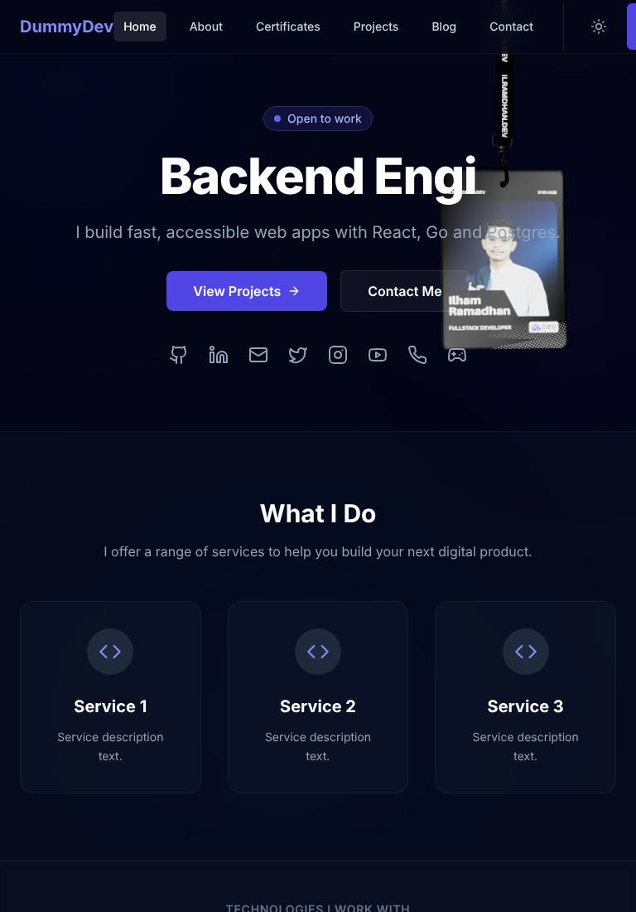
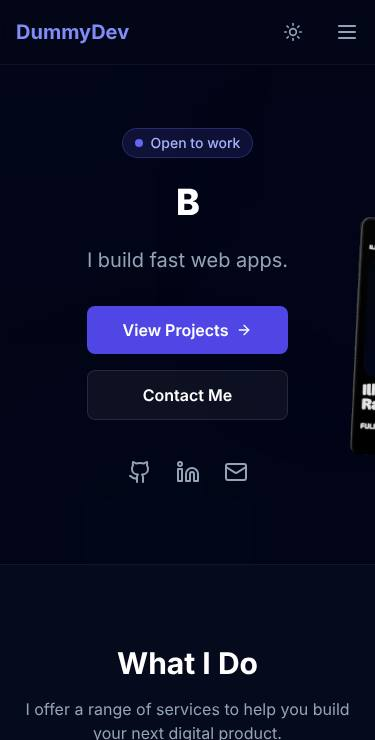
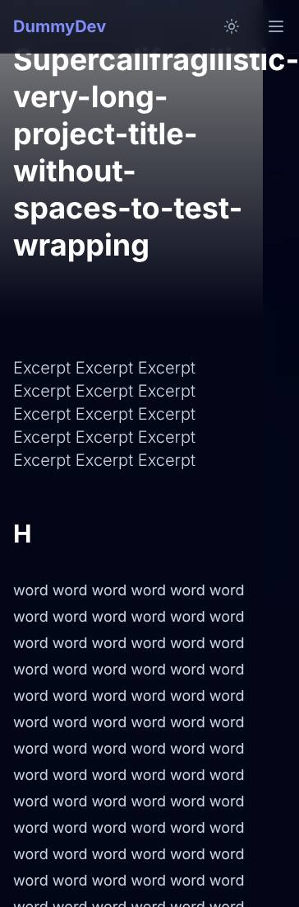
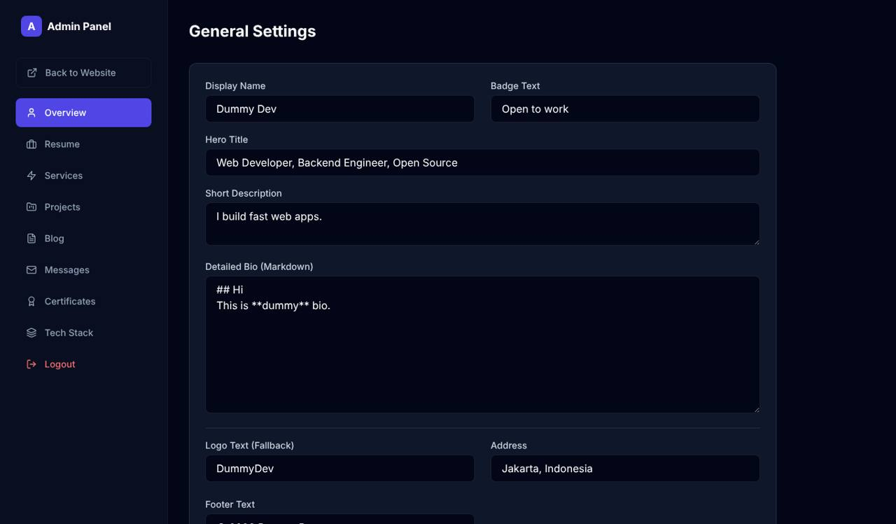

# Repository Audit — ilramdhan.dev

> **Audit date:** 2026-10-10 · **Commit audited:** `03a6712` (main) · **Scope:** every file in the repo, from root config down to the deepest component, plus a production build tested in a headless browser with a mocked Supabase backend.
>
> This document lists **what is wrong or missing, with evidence**. The **how / in what order** lives in [`../PLAN.md`](../PLAN.md). Every finding has a stable ID (`SEC-01`, `PERF-02`, …) that the plan and the GitHub issues reference.

---

## 0. How this audit was done

| Step                   | What                                                                                                                                                                                                   | Result                                                                                                                                                                      |
| ---------------------- | ------------------------------------------------------------------------------------------------------------------------------------------------------------------------------------------------------ | --------------------------------------------------------------------------------------------------------------------------------------------------------------------------- |
| Static review          | Read all ~6,300 lines (TS/TSX/SQL/config/docs)                                                                                                                                                         | Findings below with `file:line`                                                                                                                                             |
| `npx tsc --noEmit`     | Type-check                                                                                                                                                                                             | ✅ passes — but `strict` is **off**, so it proves little                                                                                                                    |
| `npm run lint`         | ESLint                                                                                                                                                                                                 | ❌ **fails** — no ESLint config exists                                                                                                                                      |
| `npm run build`        | Vite production build                                                                                                                                                                                  | ✅ builds, **one 4.27 MB JS chunk (1.39 MB gzip)**                                                                                                                          |
| `npm audit --omit=dev` | Prod dependency audit                                                                                                                                                                                  | ❌ **32 vulnerabilities (2 critical, 23 high)** — mostly from unused deps                                                                                                   |
| Playwright (Chromium)  | Prod build served locally, Supabase REST mocked with dummy data, 11 routes × 2 viewports + 7 routes × 10 viewports (320 → 2560 px), reduced-motion run, keyboard run, "random GitHub user" session run | Measurements and screenshots below                                                                                                                                          |
| Live site              | `https://ilramdhan.dev`                                                                                                                                                                                | ⚠️ Not reachable from the audit sandbox (egress policy). Live-only checks (real response headers, Lighthouse on prod, real OG scrape) are listed as follow-ups in the plan. |

The audit harness scripts are kept in [`harness/`](./harness) so the next session can re-run them.

### Severity scale

| Level           | Meaning                                                  |
| --------------- | -------------------------------------------------------- |
| 🔴 **Critical** | Exploitable now or user-facing breakage on every visit   |
| 🟠 **High**     | Security weakness / major perf/SEO loss / broken feature |
| 🟡 **Medium**   | Noticeable quality, maintainability or UX problem        |
| 🟢 **Low**      | Polish, hygiene, nice-to-have                            |

> **Owner decision recorded:** Supabase "Allow new users to sign up" is **already OFF**, so the authorization findings are rated **High** (defense-in-depth) rather than Critical.

---

## 1. Measured results (headline numbers)

| Metric                                                   | Measured                                                               | Target                          |
| -------------------------------------------------------- | ---------------------------------------------------------------------- | ------------------------------- |
| JS shipped on **every** route (incl. `/privacy`)         | **4,167 KB** (1 file)                                                  | < 200 KB gzip initial           |
| 3D model `card.glb` downloaded on **every** route        | **3,849 KB**                                                           | ≤ 400 KB, home only, after idle |
| Total transfer per page view                             | **~8.1 MB**                                                            | < 1 MB                          |
| Home CLS (all 10 viewports)                              | **0.21 – 0.55** (Poor)                                                 | < 0.1                           |
| Home long tasks (> 50 ms) during load                    | **13 – 20**                                                            | < 3                             |
| WebGL contexts on home                                   | **2** (R3F card + Vanta globe)                                         | ≤ 1, paused off-screen          |
| Running animations with `prefers-reduced-motion: reduce` | **6 + 2 canvases** (ignored)                                           | 0 non-essential                 |
| `<a href>` links on `/blog`                              | **0** (all navigation is `onClick`)                                    | every card/nav item is a link   |
| Nameless buttons on home                                 | **9** (+3 nameless links)                                              | 0                               |
| `<main>` landmark                                        | only on home                                                           | every page                      |
| Canonical URL                                            | `https://ilramdhan.dev/` on **every** page                             | self-referencing per page       |
| Unknown URL (e.g. `/xyz`)                                | **blank white page**, HTTP 200                                         | 404 page + `noindex`            |
| Horizontal scroll                                        | `/projects/:slug` & `/blog/:slug` at **320/360 px** (doc width 364 px) | none                            |
| Navbar at **768 px**                                     | "Sign In" clipped off-screen (links span 137→819 px)                   | fits                            |

Screenshots: [`screenshots/`](./screenshots)

|                                                           |                                                               |
| --------------------------------------------------------- | ------------------------------------------------------------- |
| Tablet 768 — navbar clipped, 3D card overlaps hero copy   |  |
| Mobile 375 — card hangs off the right edge                |          |
| Mobile 320 — detail page wider than viewport              |   |
| Unknown route — blank page                                |                  |
| `/admin` rendered for a session that is **not** the owner |    |

---

## 2. Findings

### 2.1 Security (`SEC`)

| ID     | Sev | Finding                                                                                                                                                                                                                                                                                                                                                                                                                                                                                                                                                                           | Evidence                                                                                                             | Fix direction                                                                                                                                                                                                                                          |
| ------ | --- | --------------------------------------------------------------------------------------------------------------------------------------------------------------------------------------------------------------------------------------------------------------------------------------------------------------------------------------------------------------------------------------------------------------------------------------------------------------------------------------------------------------------------------------------------------------------------------- | -------------------------------------------------------------------------------------------------------------------- | ------------------------------------------------------------------------------------------------------------------------------------------------------------------------------------------------------------------------------------------------------ |
| SEC-01 | 🟠  | **Authorization = "any logged-in user".** `messages` and `blog_comments` policies grant SELECT/UPDATE/DELETE to `auth.role() = 'authenticated'`; Storage lets any authenticated user write/delete; content tables let _any_ user INSERT rows with their own `user_id`, which are then publicly visible (`SELECT USING (true)`). The UI gate `ProtectedRoute` only checks `user != null` — verified: a session for an arbitrary GitHub account renders the full dashboard. Safe today only because sign-ups are off; one toggle (or a future email/password provider) re-opens it. | `supabase/supabase-fix.sql:256-263, 310-314`, `supabase/schema.sql:163-170`, `index.tsx:27-35`, `lib/auth.tsx:42-46` | Single owner model: `public.is_admin()` (SECURITY DEFINER, checks `auth.uid()` in an `admin_users` table or `app_metadata.role = 'admin'`). Rewrite every write policy + storage policies to `is_admin()`. UI: `useIsAdmin()` and redirect non-admins. |
| SEC-02 | 🟠  | **Storage hardening.** Bucket policy is `FOR ALL … WITH CHECK (bucket_id = …)` with no `USING`, no MIME/size restriction, no path restriction. Upload code trusts `file.name` and any file type (SVG/HTML could be uploaded and served from the Supabase domain).                                                                                                                                                                                                                                                                                                                 | `supabase/schema.sql:167-170`, `app/admin/*Tab.tsx` upload blocks                                                    | Bucket `allowed_mime_types` (image/webp, image/png, image/jpeg, application/pdf), `file_size_limit`; separate INSERT/UPDATE/DELETE policies gated by `is_admin()`; sanitized, random file names.                                                       |
| SEC-03 | 🟡  | **PostgREST filter injection.** Search text is interpolated into an `.or()` filter string; `,`, `(`, `)` or `.` in input changes the filter or errors. `%`/`_` act as wildcards.                                                                                                                                                                                                                                                                                                                                                                                                  | `lib/api.ts:263` (also `:147` ilike)                                                                                 | Escape/strip reserved chars, or move search to an RPC / `textSearch` on a generated `tsvector`.                                                                                                                                                        |
| SEC-04 | 🟡  | **Spam/abuse is only blocked client-side.** Honeypot + cooldown live in React; anyone with the public anon key can POST unlimited rows to `messages`/`blog_comments`. Comments publish instantly (no moderation). Length limits exist only in RLS `WITH CHECK`, not as column constraints.                                                                                                                                                                                                                                                                                        | `components/ContactForm.tsx:49-55`, `app/blog-detail.tsx:51-97`, `supabase-fix.sql:247-253, 298-303`                 | Cloudflare Turnstile (free) verified in a Vercel Function or Supabase Edge Function that does the insert; revoke anon INSERT; `is_approved` for comments; `CHECK (char_length(...))` constraints; per-IP rate limit.                                   |
| SEC-05 | 🟡  | **No security headers.** `vercel.json` sets none: no CSP, HSTS, `X-Frame-Options`/`frame-ancestors`, `Referrer-Policy`, `Permissions-Policy`, `X-Content-Type-Options`.                                                                                                                                                                                                                                                                                                                                                                                                           | `vercel.json`                                                                                                        | Add a `headers` block; CSP allowing self, Supabase, Wakatime, simpleicons, GitHub stats images. (Verify on live with securityheaders.com.)                                                                                                             |
| SEC-06 | 🟢  | **Unused serverless proxy.** `api/wakatime.ts` is deployed but never called (the client fetches the public Wakatime share JSON directly). _Update: PR #13 (merged after this audit) hardened it — `Authorization` header instead of `?api_key=`, GET-only, timeout + retry, generic client errors — so the remaining issue is only that it's unused and keeps `@vercel/node` in dependencies._                                                                                                                                                                                    | `api/wakatime.ts`; client calls Wakatime directly at `lib/api.ts:333,352`                                            | Delete it, or make it the single source and switch the client to `/api/wakatime`.                                                                                                                                                                      |
| SEC-07 | 🟢  | **Vulnerable / unused dependencies.** `next-themes` (unused) pulls in `next@16` + `sharp` (critical advisories); `@vercel/node` (unused at runtime) is a prod dependency with a large vulnerable tree; `react-router-dom` has a high advisory.                                                                                                                                                                                                                                                                                                                                    | `package.json`, `npm audit`                                                                                          | Remove unused deps, bump router, add Dependabot + `npm audit` in CI.                                                                                                                                                                                   |
| SEC-08 | 🟢  | **Destructive schema script.** `schema.sql` starts with `DROP TABLE … CASCADE` for all tables — one accidental run wipes production. No migration history.                                                                                                                                                                                                                                                                                                                                                                                                                        | `supabase/schema.sql:1-10`                                                                                           | Supabase CLI migrations; keep a non-destructive baseline; never `DROP` in shared scripts.                                                                                                                                                              |
| SEC-09 | 🟢  | **Privacy/data handling.** Contact form stores name+email+message indefinitely; "Last updated" on Privacy/Terms is _today's date_ on every visit (legally misleading).                                                                                                                                                                                                                                                                                                                                                                                                            | `app/privacy.tsx:34`, `app/terms.tsx:34`                                                                             | Store `privacy_updated_at`; retention policy; mention Supabase/Vercel/analytics processors.                                                                                                                                                            |

### 2.2 Performance (`PERF`)

| ID      | Sev | Finding                                                                                                                                                                                                          | Evidence                                                 | Fix direction                                                                                                                                                                                                                              |
| ------- | --- | ---------------------------------------------------------------------------------------------------------------------------------------------------------------------------------------------------------------- | -------------------------------------------------------- | ------------------------------------------------------------------------------------------------------------------------------------------------------------------------------------------------------------------------------------------ |
| PERF-01 | 🔴  | **No code splitting.** Every page, the whole admin dashboard, three.js, rapier (WASM), drei, Vanta, recharts and react-markdown ship in one 4.27 MB chunk to every visitor.                                      | `index.tsx:7-17` static imports; build output            | `React.lazy` per route (admin separately), dynamic import for `Hero3D`, Vanta, recharts; `manualChunks` for vendors; bundle budget in CI.                                                                                                  |
| PERF-02 | 🔴  | **3.8 MB GLB preloaded on every route.** `useGLTF.preload` / `useTexture.preload` run at module scope in `Hero.tsx`, which is imported eagerly, so `/privacy` also downloads the model.                          | `components/Hero.tsx:247-248`; measured on all routes    | Compress with gltf-transform (meshopt/Draco + WebP/KTX2 textures, target ≤ 400 KB); preload only inside the lazy 3D component, after `requestIdleCallback`, desktop + `prefers-reduced-motion: no-preference` only; static image fallback. |
| PERF-03 | 🟠  | **Two continuous WebGL scenes + physics on home.** R3F lanyard (Rapier physics @60 fps) + Vanta GLOBE (another full three.js copy) never pause when off-screen; mobile runs them too. 13–20 long tasks per load. | `components/Hero.tsx:296-312`, `app/page.tsx:77-101`     | `frameloop="demand"`/pause via IntersectionObserver; drop Vanta (CSS/SVG gradient instead); disable physics on touch devices; `dpr={[1, 1.5]}`.                                                                                            |
| PERF-04 | 🟠  | **Home CLS 0.21–0.55 (Poor).** Hero renders a short skeleton then real content; typewriter changes H1 width; sections mount after data; images have no dimensions.                                               | Playwright CLS observer, all viewports                   | Reserve space (min-heights, aspect-ratio boxes), static H1, `width`/`height` on images, skeletons with final dimensions, prerendered HTML (SEO-02).                                                                                        |
| PERF-05 | 🟡  | **Images unoptimized.** No `loading="lazy"`/`decoding="async"` (15 eager images on home), no dimensions, originals uploaded at full size (Supabase image transforms are not on the free tier).                   | all ``; `app/admin/*Tab.tsx` uploads                | Compress/resize to WebP in the browser on upload (e.g. `browser-image-compression`), store width/height, ``; `fetchpriority="high"` for LCP image.                                       |
| PERF-06 | 🟡  | **React Query defaults.** `staleTime: 0` ⇒ every mount/window-focus refetches; `profile` is fetched by Navbar, Hero, Footer, page…                                                                               | `index.tsx:20`                                           | `staleTime` 5 min, `refetchOnWindowFocus: false` for public data, query-options factory.                                                                                                                                                   |
| PERF-07 | 🟡  | **Over-fetching.** `select('*')` everywhere, including full markdown `content` for list cards; tag/issuer lists download whole columns of every row and dedupe in JS.                                            | `lib/api.ts` (all getters), `:126-131, 162-167, 273-278` | Select explicit columns per view; distinct values via a view or RPC.                                                                                                                                                                       |
| PERF-08 | 🟢  | **Missing DB indexes** for hot filters: `is_featured`, `published_at`, `created_at`, `issued_date`, `tags` (GIN), `blog_comments.blog_id`.                                                                       | `supabase/schema.sql`                                    | Add indexes in a migration.                                                                                                                                                                                                                |
| PERF-09 | 🟢  | **Dead font hints + heavy decorative layers.** Preconnects to Google Fonts but loads no font; three full-screen `blur-[100–150px]` blobs with `animate-pulse` on every page.                                     | `index.html:50-51`, `App.tsx:10-18`                      | Remove hints or self-host a font with `font-display: swap`; replace blobs with a static gradient image or animate only `opacity/transform`.                                                                                                |
| PERF-10 | 🟢  | **Caching headers** not configured for hashed assets / GLB.                                                                                                                                                      | `vercel.json`                                            | `Cache-Control: public, max-age=31536000, immutable` for `/assets/*`.                                                                                                                                                                      |

### 2.3 SEO & social sharing (`SEO`)

| ID     | Sev | Finding                                                                                                                                                                                                                                                                                                                     | Evidence                                                                                                                      | Fix direction                                                                                                                                                                                                                                        |
| ------ | --- | --------------------------------------------------------------------------------------------------------------------------------------------------------------------------------------------------------------------------------------------------------------------------------------------------------------------------- | ----------------------------------------------------------------------------------------------------------------------------- | ---------------------------------------------------------------------------------------------------------------------------------------------------------------------------------------------------------------------------------------------------- |
| SEO-01 | 🔴  | **Same canonical on every page.** `<link rel="canonical" href="https://ilramdhan.dev/">` is hard-coded and never updated, so every project/blog page tells Google "I am a duplicate of the home page".                                                                                                                      | `index.html:16`; `lib/useDocumentMeta.ts` never touches canonical; measured on all routes                                     | Per-route canonical (absolute, no query/hash) in a single `<Seo>` component.                                                                                                                                                                         |
| SEO-02 | 🟠  | **Client-only rendering.** Crawlers that don't run JS and _all_ social scrapers (WhatsApp, LinkedIn, Facebook, X, Discord, Telegram) receive the same generic `index.html` for every URL; per-page title/description/OG set by `useDocumentMeta` are invisible to them.                                                     | `index.html`, `lib/useDocumentMeta.ts`                                                                                        | Build-time prerendering of all public routes including every `/projects/:slug` and `/blog/:slug` (fetched from Supabase at build), with full head tags in the HTML. Re-deploy automatically on publish via Vercel Deploy Hook (Supabase DB webhook). |
| SEO-03 | 🟠  | **OG image is wrong.** Uses `/logo.png` (479×179) with `twitter:card=summary_large_image` (needs ≈1200×630, 1.91:1); default in `useDocumentMeta` is a **relative** URL (`/logo.png`) which scrapers reject; no `og:image:width/height/alt`; no per-post images.                                                            | `index.html:32,47`, `lib/useDocumentMeta.ts:13`                                                                               | 1200×630 branded default; build-time generated OG image per project/blog (satori/resvg or `@vercel/og`), absolute URLs, width/height/alt, `og:locale` + alternates for i18n.                                                                         |
| SEO-04 | 🟡  | **Static sitemap** lists 7 fixed URLs, no project/blog detail pages, no `lastmod`.                                                                                                                                                                                                                                          | `public/sitemap.xml`                                                                                                          | Generate at build from Supabase (with `lastmod`, i18n alternates); RSS feed for the blog.                                                                                                                                                            |
| SEO-05 | 🟡  | **Soft 404s.** No catch-all route (blank page, HTTP 200); unknown slugs render "Not Found" with HTTP 200 and the previous page's meta.                                                                                                                                                                                      | `index.tsx:41-60`, `app/blog-detail.tsx:80-87`                                                                                | `NotFound` page with `noindex`; prerendered `404.html` (Vercel serves it with 404); map `PGRST116` to not-found.                                                                                                                                     |
| SEO-06 | 🟡  | **Home `<h1>` is empty at load** — it contains only the typewriter text (measured `""`); the owner's name is never in an H1.                                                                                                                                                                                                | `components/Hero.tsx:334-336`                                                                                                 | Static H1 "Ilham Ramadhan — Full-stack Developer"; typewriter as a decorative, `aria-hidden` line.                                                                                                                                                   |
| SEO-07 | 🟡  | **Navigation is not crawlable.** Navbar, footer, cards and "View all" use `<button onClick={navigate}>` / clickable `
`s — no `href` for crawlers, no middle-click/open-in-new-tab, no prefetch. `/blog` has 0 anchors.                                                                                                 | `components/Navbar.tsx:77-87`, `App.tsx:35-36`, `components/ProjectCard.tsx:26`, `app/blog.tsx:90-93`, `app/page.tsx:225-228` | `<Link to>` / `<a href>` everywhere; one link per card.                                                                                                                                                                                              |
| SEO-08 | 🟡  | **Structured data thin and possibly wrong.** Only one `Person` JSON-LD with `sameAs` pointing at `github.com/ilramadhan` / `linkedin.com/in/ilramadhan` while the GitHub account is `ilramdhan` (verify). No `WebSite`, `BlogPosting`, `CreativeWork`, `BreadcrumbList`.                                                    | `index.html:67-82`                                                                                                            | Fix URLs; per-page JSON-LD from the same `<Seo>` component.                                                                                                                                                                                          |
| SEO-09 | 🟢  | **Stale meta between routes.** Cleanup only resets the title; description/og:* keep the previous page's values; `/privacy`, `/terms`, `/login`, `/admin` never set meta; `/login` and `/admin` should be `noindex` (robots.txt `Disallow` doesn't prevent indexing). Privacy/Terms render two `<h1>` (page + markdown `#`). | `lib/useDocumentMeta.ts:66-69`, `app/privacy.tsx`, `app/terms.tsx`, `app/login.tsx`                                           | `react-helmet-async` (or equivalent) with defaults per route; markdown heading offset.                                                                                                                                                               |
| SEO-10 | 🟢  | **Icons/manifest.** Only PNG favicons; no SVG favicon, `apple-touch-icon`, `site.webmanifest`; `theme-color` not adapted to dark/light.                                                                                                                                                                                     | `index.html:54-65`                                                                                                            | Full icon set + manifest.                                                                                                                                                                                                                            |
| SEO-11 | 🟢  | **Blog meta missing:** `article:published_time`, `article:modified_time`, `article:tag`, author, reading time; no RSS.                                                                                                                                                                                                      | `app/blog-detail.tsx`                                                                                                         | Add with BlogPosting JSON-LD; `/rss.xml` generated at build.                                                                                                                                                                                         |

### 2.4 Accessibility (`A11Y`)

| ID      | Sev | Finding                                                                                                                                                                                                                      | Evidence                                                                                                                        | Fix direction                                                                                                   |
| ------- | --- | ---------------------------------------------------------------------------------------------------------------------------------------------------------------------------------------------------------------------------- | ------------------------------------------------------------------------------------------------------------------------------- | --------------------------------------------------------------------------------------------------------------- |
| A11Y-01 | 🟡  | **Icon-only controls have no accessible name**: theme toggle, mobile menu toggle, carousel arrows, social icons, admin edit/delete, admin mobile menu. Measured 9 nameless buttons + 3 nameless links on home.               | `components/Navbar.tsx:92-120`, `components/Hero.tsx:363`, `components/ImageCarousel.tsx:44-49`, `app/about.tsx:85`, admin tabs | `aria-label` (translated); `title` is not enough.                                                               |
| A11Y-02 | 🟡  | **Clickable non-interactive elements** (cards as `div`/`article` with `onClick`) are unreachable by keyboard.                                                                                                                | see SEO-07                                                                                                                      | Real links (fixes both).                                                                                        |
| A11Y-03 | 🟡  | **Landmarks & skip link.** No skip-to-content link; `<main>` only on home; footer nav is buttons; nav has no `aria-label`.                                                                                                   | Playwright landmark count                                                                                                       | Layout component with `<header><nav aria-label><main id="content"><footer>`; skip link.                         |
| A11Y-04 | 🟡  | **Forms.** Search inputs have no label; comment-form labels are not associated (`htmlFor`/`id` missing); admin forms are placeholder-only; validation errors not linked (`aria-describedby`, `aria-invalid`), not announced. | `app/blog.tsx:65-71`, `app/certificates.tsx:72-78`, `app/blog-detail.tsx:144-165`, admin tabs                                   | Shared `<Field>` component.                                                                                     |
| A11Y-05 | 🟡  | **Motion ignores user preference.** With `prefers-reduced-motion: reduce` there are still 6 running animations and 2 WebGL canvases; the H1 typewriter loops forever (screen readers re-announce).                           | Playwright reduced-motion run                                                                                                   | `MotionConfig reducedMotion="user"`, Tailwind `motion-safe:`, skip WebGL/Vanta/marquee/typewriter when reduced. |
| A11Y-06 | 🟡  | **Hover-only affordances.** Admin edit/delete buttons are `opacity-0 group-hover:opacity-100` (invisible on touch and on keyboard focus); carousel arrows appear only on hover.                                              | 5 places in `app/admin/*`, `components/ImageCarousel.tsx:43`                                                                    | Always visible on touch / `focus-within:opacity-100`.                                                           |
| A11Y-07 | 🟢  | **Small touch targets.** 2–7 targets < 24×24 px per page (social icons, carousel arrows, dots, icon buttons).                                                                                                                | Playwright, all viewports                                                                                                       | Min 44×44 hit area (padding).                                                                                   |
| A11Y-08 | 🟢  | **Mobile menu** lacks `aria-expanded`/`aria-controls`, Esc-to-close, focus management; admin sidebar overlay has no focus trap.                                                                                              | `components/Navbar.tsx:115-151`, `app/admin.tsx:98-152`                                                                         | Accessible disclosure / dialog pattern.                                                                         |
| A11Y-09 | 🟢  | **Contrast** of `text-slate-500` small text and `opacity-60 grayscale` tech logos needs verification (axe). `lang` fixed to `en`.                                                                                            | various                                                                                                                         | axe in CI; set `lang` per locale.                                                                               |

### 2.5 UX, UI & responsiveness (`UX`)

| ID    | Sev | Finding                                                                                                                                                                                                                                                                                                                                                               | Evidence                                                                                                                                  | Fix direction                                                                                                                                                                                             |
| ----- | --- | --------------------------------------------------------------------------------------------------------------------------------------------------------------------------------------------------------------------------------------------------------------------------------------------------------------------------------------------------------------------- | ----------------------------------------------------------------------------------------------------------------------------------------- | --------------------------------------------------------------------------------------------------------------------------------------------------------------------------------------------------------- |
| UX-01 | 🟠  | **Bug — blog tag filter does nothing.** `selectedTag` is in the query key but never passed to `getBlogs`, and `getBlogs` has no tag parameter. Verified: clicking `#react` sends `…/blogs?select=*&order=published_at.desc&offset=0&limit=6` (no tag filter).                                                                                                         | `app/blog.tsx:31-35`, `lib/api.ts:145-154`                                                                                                | Add `tag` to `getBlogs` (`.contains('tags',[tag])`) and pass it.                                                                                                                                          |
| UX-02 | 🟠  | **Responsive breakage.** (a) **768 px:** desktop nav switches on at `md` but doesn't fit — "Sign In" is pushed off-screen. (b) **768–1023 px:** the 3D card sits on top of the hero text/CTA (spacer is `lg:` only). (c) **≤ 414 px:** card hangs off the right edge. (d) **320–360 px:** long unbroken titles/code blocks make detail pages wider than the viewport. | Screenshots in §1; `components/Navbar.tsx:74`, `components/Hero.tsx:153-155, 373`, `app/blog-detail.tsx:120`, `app/project-detail.tsx:58` | Nav switch at `lg`; card hidden or placed below the copy under `lg`; `break-words`/`hyphens-auto` on titles; `overflow-x-auto` on `pre`/tables; test matrix 320/360/390/414/768/1024/1280/1440/1920/2560. |
| UX-03 | 🟡  | **No 404 page and no error boundary** — any render error or unknown URL = white screen.                                                                                                                                                                                                                                                                               | `index.tsx`; screenshot                                                                                                                   | Catch-all route + `errorElement`/ErrorBoundary with retry.                                                                                                                                                |
| UX-04 | 🟡  | **Theme flash & no system preference.** Theme class applied in `useEffect` after first paint; default is forced dark (ignores `prefers-color-scheme`); unknown routes render light even when dark is saved (provider sits inside `App` route).                                                                                                                        | `lib/ThemeContext.tsx:26-43`, screenshot                                                                                                  | Inline pre-paint script in `index.html`; `light / dark / system`; provider at root.                                                                                                                       |
| UX-05 | 🟡  | **Loading/empty/error states inconsistent.** Plain "Loading..." text, full-page spinners, About blocks the whole page on 4 queries, errors have no retry; Hero skeleton → content jump (CLS).                                                                                                                                                                         | `app/about.tsx:42,57-59`, `app/privacy.tsx:17-23`, admin tabs                                                                             | Shared `Skeleton`, `EmptyState`, `ErrorState(retry)`; render sections independently.                                                                                                                      |
| UX-06 | 🟢  | **Filter/search/page state not in the URL** — lost on refresh/back, can't be shared; pagination renders every page number.                                                                                                                                                                                                                                            | `app/projects.tsx`, `app/blog.tsx`, `app/certificates.tsx`                                                                                | `useSearchParams`; compact pagination with ellipsis.                                                                                                                                                      |
| UX-07 | 🟢  | **Dates** use `toLocaleDateString()` with the browser default locale; certificate dates are raw ISO strings.                                                                                                                                                                                                                                                          | many files                                                                                                                                | `Intl.DateTimeFormat(locale, …)` helper tied to i18n.                                                                                                                                                     |
| UX-08 | 🟢  | **Duplicate success toast** on contact form (mutation-level and call-level `onSuccess` both toast).                                                                                                                                                                                                                                                                   | `components/ContactForm.tsx:34, 70`                                                                                                       | Keep one.                                                                                                                                                                                                 |
| UX-09 | 🟢  | **Content details.** "Download CV" links to `#` when no CV; public navbar shows "Sign In" to every visitor; login page has stacked "Welcome Back" H1 + "Admin Login" H2; GitHub graph link hard-coded to `ilramdhan` while the image uses the profile username.                                                                                                       | `app/about.tsx:93, 223`, `components/Navbar.tsx:99-104`, `app/login.tsx:32-34`                                                            | Hide CV/login when absent; consistent username source.                                                                                                                                                    |
| UX-10 | 🟢  | **Blog reading experience.** No GFM (tables, task lists), no syntax highlighting, no heading anchors/TOC, no reading time, no share buttons, no prev/next, cover is only `images[0]`. Projects: same markdown limits; carousel has no swipe/keyboard.                                                                                                                 | `app/blog-detail.tsx`, `app/project-detail.tsx`, `components/ImageCarousel.tsx`                                                           | `remark-gfm`, `rehype-slug`, `rehype-autolink-headings`, a light highlighter (Shiki at build / `rehype-highlight`), swipe + arrow keys.                                                                   |

### 2.6 Animation & motion (`ANIM`)

| ID      | Sev | Finding                                                                                                                                                                                                                                                                                                                                                                                                                                                                 | Evidence                                                                                         | Fix direction                                                                                                                                                                                                                                                                                |
| ------- | --- | ----------------------------------------------------------------------------------------------------------------------------------------------------------------------------------------------------------------------------------------------------------------------------------------------------------------------------------------------------------------------------------------------------------------------------------------------------------------------- | ------------------------------------------------------------------------------------------------ | -------------------------------------------------------------------------------------------------------------------------------------------------------------------------------------------------------------------------------------------------------------------------------------------- |
| ANIM-01 | 🟡  | **`whileInView` without `viewport={{ once: true }}`** on services, about timeline, about/certificate cards → elements fade out/in again every time you scroll past (feels jittery, extra work). Only `ProjectCard` sets `once`. Delays grow linearly with index (`idx * 0.1`), so long lists wait seconds.                                                                                                                                                              | `app/page.tsx:122`, `app/about.tsx:111,128,157`, `app/certificates.tsx:99-104`                   | Shared `Reveal` component: `once: true`, `amount: 0.2`, capped stagger via parent `variants` (`staggerChildren: 0.06`, max ~0.4 s).                                                                                                                                                          |
| ANIM-02 | 🟡  | **No route transitions & abrupt scroll.** Page swaps are instant; `ScrollToTop` jumps to 0 before the new page paints; in-page anchor scrolls use `setTimeout(100)` hacks and land under the fixed navbar.                                                                                                                                                                                                                                                              | `components/ScrollToTop.tsx:10-12`, `components/Navbar.tsx:33-37`, `components/Hero.tsx:274-278` | Short fade/slide (≤ 200 ms) with `AnimatePresence` or the View Transitions API (progressive enhancement); React Router `ScrollRestoration`; `scroll-margin-top` on sections; `scroll-behavior: smooth` only under `motion-safe`.                                                             |
| ANIM-03 | 🟡  | **Expensive decorative animation.** Three viewport-sized blobs with 100–150 px blur `animate-pulse` forever on every page; Vanta globe animates continuously in the contact section; tech marquee runs even off-screen.                                                                                                                                                                                                                                                 | `App.tsx:10-18`, `app/page.tsx:77-101, 143-173`                                                  | Static gradient (or animate `transform` on a pre-blurred image), pause when off-screen, respect reduced motion.                                                                                                                                                                              |
| ANIM-04 | 🟡  | **Typewriter in the H1** loops infinitely, shifts layout (CLS), hurts SEO/a11y (SEO-06, A11Y-05).                                                                                                                                                                                                                                                                                                                                                                       | `components/Hero.tsx:259-267, 334-336`                                                           | Static H1 + rotating role line with reserved width (`min-w`/`ch` units) and `aria-live="off"`; stop after one loop or on reduced motion.                                                                                                                                                     |
| ANIM-05 | 🟢  | **Missing micro-interactions** expected in a polished portfolio: carousel image swap has no transition; theme toggle has no icon/colour transition (and `transition-colors` on `body` + every element makes theme switching repaint the whole page); Wakatime bars have `transition-all duration-1000` but width is set immediately so nothing animates; skeletons pulse instead of shimmer; navbar has no "scrolled" state; active nav item has no animated indicator. | `components/ImageCarousel.tsx`, `components/Navbar.tsx`, `app/about.tsx:202-206`, `global.css:7` | Crossfade carousel (+ swipe), animated active-link pill (`layoutId`), navbar shrink/blur on scroll, theme switch via View Transitions (circular reveal), bars animate from 0 on inView, number counters for stats, button press feedback (`active:scale-[0.98]`). All behind reduced-motion. |
| ANIM-06 | 🟢  | **3D card UX.** Canvas wrapper is `pointer-events-none`, so the lanyard can't actually be dragged although the code implements drag; on touch it's purely decorative but still runs physics.                                                                                                                                                                                                                                                                            | `components/Hero.tsx:297-298`                                                                    | Enable pointer events on the card area only (desktop), static image on touch/reduced-motion.                                                                                                                                                                                                 |

### 2.7 Admin dashboard (`ADM`)

| ID     | Sev | Finding                                                                                                                                                                                                                                                                                                   | Evidence                                                    | Fix direction                                                                                              |
| ------ | --- | --------------------------------------------------------------------------------------------------------------------------------------------------------------------------------------------------------------------------------------------------------------------------------------------------------- | ----------------------------------------------------------- | ---------------------------------------------------------------------------------------------------------- |
| ADM-01 | 🟠  | **Delete without confirmation** for projects, blogs, certificates, services, tech stack, resume items, single messages — one mis-click destroys content.                                                                                                                                                  | `app/admin/*Tab.tsx` delete buttons                         | Confirm dialog (or soft-delete + undo toast).                                                              |
| ADM-02 | 🟠  | **Slug regenerated on every save** from the title → editing a typo changes the public URL, breaking shared links and SEO; duplicate titles crash on the `UNIQUE` constraint; non-Latin titles produce an empty slug.                                                                                      | `app/admin/ProjectsTab.tsx:129`, `app/admin/BlogTab.tsx:89` | Generate once on create, editable field, uniqueness check with suffix; optional `slug_history` redirects.  |
| ADM-03 | 🟡  | **Storage leaks.** Removing an image or deleting a row never deletes the file; avatar/logo/CV uploads always create new objects; raw `file.name` used in paths. Free tier = 1 GB.                                                                                                                         | upload blocks in all tabs                                   | Delete objects on remove/delete (or a periodic cleanup function), sanitized random names.                  |
| ADM-04 | 🟡  | **No upload validation / compression / progress.** Any type, any size.                                                                                                                                                                                                                                    | same                                                        | Client validation + compression (PERF-05), progress UI.                                                    |
| ADM-05 | 🟡  | **No drafts or scheduling.** `published_at` is always set to _now_ on create; an article can't be saved as draft or unpublished.                                                                                                                                                                          | `app/admin/BlogTab.tsx:92`                                  | `status` (draft/published) + `published_at` picker + preview link.                                         |
| ADM-06 | 🟡  | **Markdown edited blind** in a plain textarea, no preview.                                                                                                                                                                                                                                                | Blog/Projects/Profile tabs                                  | Split editor/preview (same renderer as public pages).                                                      |
| ADM-07 | 🟡  | **No comment moderation** in the dashboard (RLS allows it but there is no UI).                                                                                                                                                                                                                            | `app/admin.tsx`                                             | Comments tab: approve/delete, filter by post.                                                              |
| ADM-08 | 🟢  | **Dashboard ergonomics.** Active tab not in URL (refresh resets); "Overview" is actually profile settings; no counts/unread badge; messages paginate client-side after fetching all; bulk delete is N sequential requests; no reply (`mailto:`) or search; items ordered by `id` with no manual ordering. | `app/admin.tsx:19`, `app/admin/MessagesTab.tsx:45-60`       | `/admin/:tab` routes, overview stats, server pagination, `.in('id', ids)`, `sort_order` + drag-to-reorder. |
| ADM-09 | 🟢  | **No new-message notification** — owner must open the dashboard to see messages.                                                                                                                                                                                                                          | —                                                           | Supabase DB webhook → Edge Function → email (Resend free tier) or Telegram bot.                            |
| ADM-10 | 🟢  | **Updates send the whole row back** (id, user_id, created_at) and skip validation; URL fields unchecked.                                                                                                                                                                                                  | all `update*` calls                                         | zod schemas shared by forms and API layer; send only changed fields.                                       |

### 2.8 Architecture, code quality, DRY (`ARCH`)

| ID      | Sev | Finding                                                                                                                                                                                                                                                                                                                                                                                                                                                                                                                                                 | Evidence                                                                                          | Fix direction                                                                                                                                                                                                                                       |
| ------- | --- | ------------------------------------------------------------------------------------------------------------------------------------------------------------------------------------------------------------------------------------------------------------------------------------------------------------------------------------------------------------------------------------------------------------------------------------------------------------------------------------------------------------------------------------------------------- | ------------------------------------------------------------------------------------------------- | --------------------------------------------------------------------------------------------------------------------------------------------------------------------------------------------------------------------------------------------------- |
| ARCH-01 | 🟡  | **Next.js-shaped folders in a Vite SPA.** `app/*.tsx` pages, unused `app/layout.tsx` with Next `metadata`, `actions/` "server actions" that are client helpers, `experimental/` SSR stub, `metadata.json` (AI-Studio leftover), root-level `App.tsx`/`index.tsx`/`types.ts`. Confusing for humans and AI sessions.                                                                                                                                                                                                                                      | tree                                                                                              | `src/` with `app/` (router, providers, layouts), `pages/`, `features/<domain>/{api,components,hooks,schemas}`, `components/ui`, `lib`, `i18n`, `styles`.                                                                                            |
| ARCH-02 | 🟡  | **Dead code & assets.** `components/band.tsx` (duplicate of `Band` inside `Hero.tsx`), `app/layout.tsx`, `experimental/`, `metadata.json`, `public/next.svg`, `public/vercel.svg`, `public/assets/images/front.png`, `back.png`, `public/logo/ir-*-nav.png` (unreferenced in code — verify the DB `logo_url` doesn't point at them), `lib/utils.ts#delay`, `actions/contact-actions.ts#submitContactForm`. Unused deps: `next-themes`, `class-variance-authority`, `@supabase/ssr`, `@vercel/node`, `@types/recharts` (recharts 3 ships its own types). | grep results                                                                                      | Delete.                                                                                                                                                                                                                                             |
| ARCH-03 | 🟡  | **Duplication.** Pagination UI ×3; upload-to-storage ×6; `generateSlug` ×2; admin CRUD tab boilerplate ×6 (form state, 3 mutations, open/close effects); certificate card ×2 (About, Certificates); tech-stack marquee item ×2; `SocialIconMap` ×2 and they differ (About lacks WhatsApp/Steam); "Loading/Not found" screens ×6; "scroll to #contact" `setTimeout` ×2; pagination math ×3.                                                                                                                                                              | files listed                                                                                      | Shared `Pagination`, `uploadFile()`, `slugify()`, `useCrudResource()` + config-driven admin forms, `CertificateCard`, `SocialLinks`, `PageState` components.                                                                                        |
| ARCH-04 | 🟡  | **Weak typing.** `strict` off; `any` in many places; `@ts-ignore`/`@ts-expect-error` in 3D code; `lib/database.types.ts` is hand-written and already diverges from the SQL (e.g. `resume.type` should be an enum, nullable FKs). `allowJs`, `experimentalDecorators`, `useDefineForClassFields:false` are template leftovers.                                                                                                                                                                                                                           | `tsconfig.json`, `lib/database.types.ts`                                                          | `strict: true`, `noUncheckedIndexedAccess`; `supabase gen types typescript` script; typed GLTF via `gltfjsx`.                                                                                                                                       |
| ARCH-05 | 🟡  | **Lint is broken** (`npm run lint` exits with "couldn't find a configuration file"); no Prettier/EditorConfig.                                                                                                                                                                                                                                                                                                                                                                                                                                          | `package.json:8`                                                                                  | ESLint flat config (typescript-eslint, react-hooks, jsx-a11y, import order), Prettier, EditorConfig, lint-staged + simple-git-hooks.                                                                                                                |
| ARCH-06 | 🟡  | **No tests, no CI.**                                                                                                                                                                                                                                                                                                                                                                                                                                                                                                                                    | —                                                                                                 | Vitest + Testing Library (units: api mappers, slugify, hooks), Playwright e2e with mocked Supabase + axe (harness in `docs/audit/harness`), GitHub Actions: typecheck → lint → test → build → bundle-size budget → Lighthouse CI on Vercel preview. |
| ARCH-07 | 🟡  | **Data layer.** One 366-line `lib/api.ts` for every entity; errors re-thrown as `new Error(message)` (loses `code`, so "not found" = generic error); query keys are ad-hoc strings; `getUserId()` uses `getSession()` (unverified) per call.                                                                                                                                                                                                                                                                                                            | `lib/api.ts`                                                                                      | Per-feature services, `queryOptions` factories with key hierarchy, typed `AppError` mapping (`PGRST116 → NotFound`), `getUser()` where server validation matters.                                                                                   |
| ARCH-08 | 🟡  | **No migrations / seed / local dev story.** Two hand-run SQL files; no `seed.sql`; developers need the production project to run the app.                                                                                                                                                                                                                                                                                                                                                                                                               | `supabase/`                                                                                       | `supabase init`, baseline migration from current prod schema, `seed.sql` with dummy data, `supabase start` documented; enums, `CHECK` constraints, `updated_at` triggers.                                                                           |
| ARCH-09 | 🟢  | **Env handling.** Missing env only `console.warn`s and creates a client with empty strings (cryptic runtime errors); no `.env.example`.                                                                                                                                                                                                                                                                                                                                                                                                                 | `lib/supabase/client.ts:13-18`                                                                    | zod-validated `env.ts`, fail fast with a helpful message; `.env.example`.                                                                                                                                                                           |
| ARCH-10 | 🟢  | **Hard-coded personal data** in code: Wakatime share URLs, GitHub username, JSON-LD, site name, OG defaults.                                                                                                                                                                                                                                                                                                                                                                                                                                            | `lib/api.ts:333,352`, `app/about.tsx:223,233`, `index.html:67-82`, `lib/useDocumentMeta.ts:11-13` | `src/config/site.ts` (+ profile table for editable bits).                                                                                                                                                                                           |
| ARCH-11 | 🟢  | **Outdated majors** (React 18→19, Router 6→7, Vite 5→7+, Tailwind 3→4, framer-motion 10→`motion` 12, lucide 0.292). Not urgent; do after tests exist. No `engines` field.                                                                                                                                                                                                                                                                                                                                                                               | `npm outdated`                                                                                    | Staged upgrade plan.                                                                                                                                                                                                                                |
| ARCH-12 | 🟢  | **No observability.** No analytics, no error tracking, no uptime monitoring.                                                                                                                                                                                                                                                                                                                                                                                                                                                                            | —                                                                                                 | Vercel Web Analytics + Speed Insights (free on Hobby), optional Sentry free tier, UptimeRobot/Better Stack free.                                                                                                                                    |

### 2.9 Internationalization (`I18N`)

| ID      | Sev | Finding                                                                                                                                                                                                       | Evidence   | Fix direction                                                                                                                                                                                                                                                                                    |
| ------- | --- | ------------------------------------------------------------------------------------------------------------------------------------------------------------------------------------------------------------- | ---------- | ------------------------------------------------------------------------------------------------------------------------------------------------------------------------------------------------------------------------------------------------------------------------------------------------ |
| I18N-01 | 🟡  | **Single language, hard-coded.** All UI strings are inline English; DB content has one language; `lang="en"` fixed; dates use the browser locale. Owner decision: **UI + content in Indonesian and English.** | everywhere | `react-i18next` (or Lingui) with `id`/`en` namespaces; localized routes `/en/...` and `/id/...` (default `en` at `/`, or language detection + redirect); `hreflang` alternates + `x-default`; translatable DB fields (see plan §4.4); admin language tabs; language switcher; `Intl` formatting. |

### 2.10 Operations & sustainability (`OPS`) — things that are easy to forget

| ID     | Sev | Finding                                                                                                                                                                       | Fix direction                                                                                                                         |
| ------ | --- | ----------------------------------------------------------------------------------------------------------------------------------------------------------------------------- | ------------------------------------------------------------------------------------------------------------------------------------- |
| OPS-01 | 🟠  | **Supabase free projects pause after ~7 days without activity.** A paused project = every section of the site shows "Error loading…" (the SPA fetches everything at runtime). | Prerendered HTML keeps the site readable even if the DB pauses; a scheduled GitHub Action that runs a tiny read query daily; monitor. |
| OPS-02 | 🟠  | **No backups.** Free tier has no PITR and limited daily backups that you can't download on schedule.                                                                          | Weekly GitHub Action `pg_dump` (via `supabase db dump`) to an encrypted artifact/private repo; Storage export script.                 |
| OPS-03 | 🟡  | **No dependency automation.**                                                                                                                                                 | Dependabot (npm + GitHub Actions), grouped minor/patch updates.                                                                       |
| OPS-04 | 🟢  | **Docs/community files missing** (LICENSE claimed but absent, no CONTRIBUTING, CoC, SECURITY, templates). README has a placeholder clone URL and outdated claims.             | Added in the same PR as this audit.                                                                                                   |
| OPS-05 | 🟢  | **Repo hygiene.** No branch protection, no conventional commits, no release tags/changelog.                                                                                   | Protect `main`, require CI, Conventional Commits, `CHANGELOG.md`.                                                                     |

---

## 3. What is already good (keep it)

- RLS is enabled on every table, and the 2nd migration already uses the `(select auth.uid())` performance pattern.
- Secrets are not in the bundle; only the public anon key is exposed (correct for Supabase).
- TanStack Query is in place (just needs configuration), pagination is server-side for public lists.
- `react-markdown` v10 escapes raw HTML and sanitizes URLs by default — no XSS found in markdown rendering.
- Honeypot + cooldown exist (good UX baseline; needs a server-side counterpart).
- Clean visual design, dark mode, consistent Tailwind palette.

---

## 4. Finding → issue map

See the issue index at the bottom of [`../PLAN.md`](../PLAN.md#9-issue-index).
